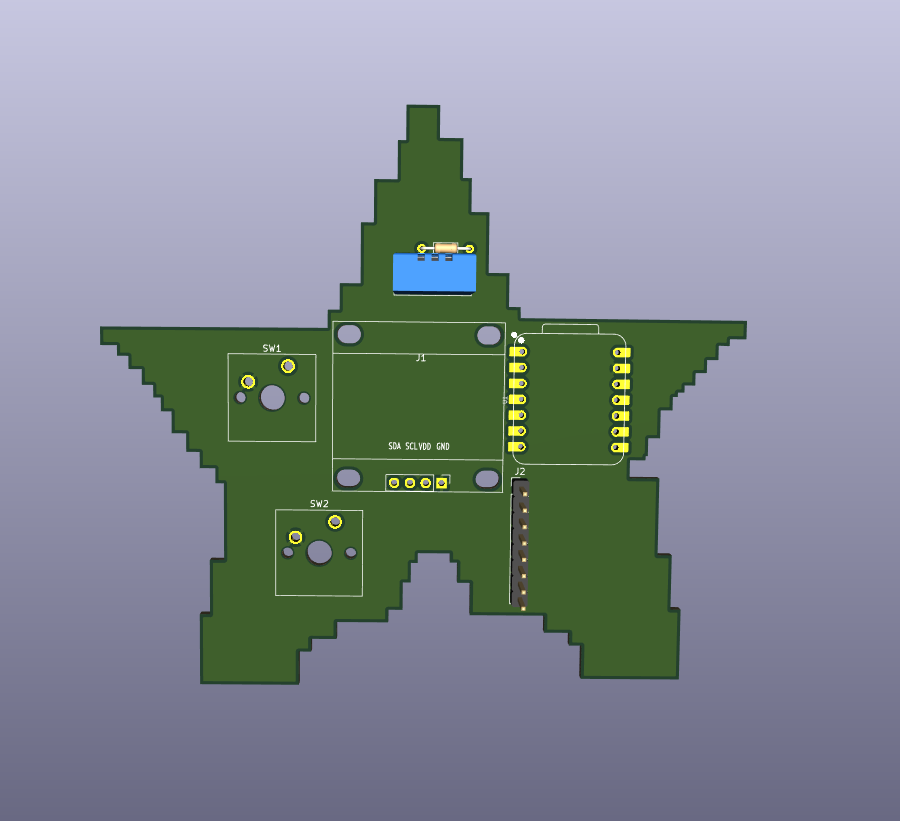
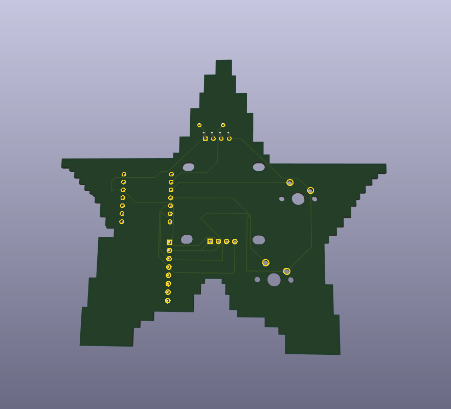
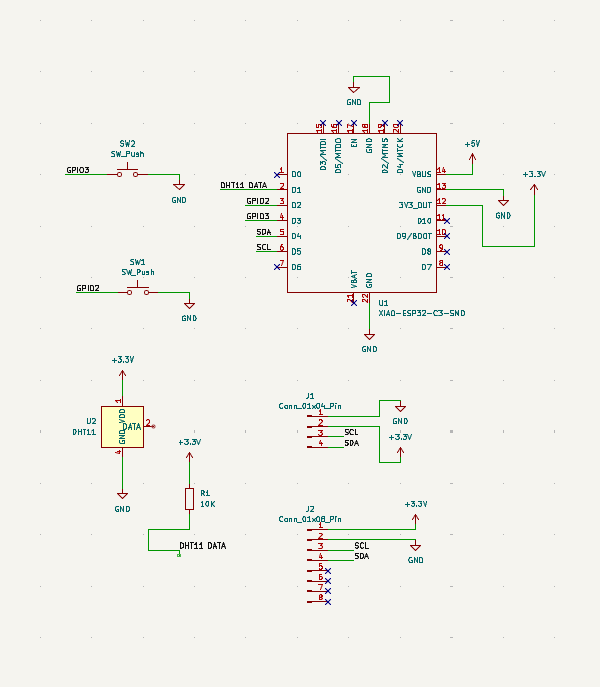
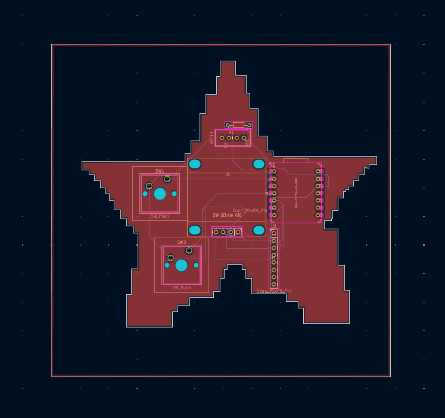

# Starbie

A small star-shaped desk pet. A tiny OLED screen shows a character that wanders around, and it reacts when you tilt the board, shake it, or press its two buttons. I designed the whole PCB myself in KiCad, following the Hack Club Starbie Week 1 guide.

## What it does

- **Button 1** opens a radial menu with four actions: NAP, PLAY, FEED and PET.
- **Tilting** the board moves a selector ball around the menu. The MPU6050 motion sensor reads the tilt.
- **Button 1 again** picks the highlighted action, and the pet reacts with a nap, hearts or a jump.
- **Button 2** shows or hides a stats screen with joy, energy and fullness, plus the room temperature and humidity from the DHT11.
- **Shaking** the board makes the pet wiggle.

## Hardware

| Part | Job |
| --- | --- |
| XIAO ESP32-C3 | the microcontroller (the brain) |
| 0.96 inch 128x64 I2C OLED | the screen |
| MPU6050 module | motion sensor for tilt and shake |
| DHT11 | temperature and humidity sensor |
| 2 x Cherry MX style switches | the two buttons |
| 10k resistor | pull-up on the DHT11 data line |

## How it is wired

| Part | XIAO pin |
| --- | --- |
| OLED and MPU6050 SDA | D4 |
| OLED and MPU6050 SCL | D5 |
| DHT11 data | D1 |
| Button 1 | D2 |
| Button 2 | D3 |

The OLED and the MPU6050 share the same two I2C wires. Everything runs on 3.3V, and the buttons connect their pin to GND when pressed.

## PCB design

- Custom star-shaped board outline on the Edge.Cuts layer
- Signal wires routed on the copper layers
- GND copper pour on the front layer, so all the ground pins connect together
- The design rules check (DRC) shows only 2 courtyard errors, which come from the supplied OLED footprint and do not affect the board

## Files

- `MyProject.kicad_sch`: schematic
- `MyProject.kicad_pcb`: board layout
- `MyProject.kicad_pro`: KiCad project file
- `gerbers.zip`: gerber and drill files, ready to send to a PCB manufacturer
- `Firmware/Starbie/Starbie.ino`: Arduino starter code from the guide (its pins already match my board)
- `Firmware/Starbie/Starbie.ino`: Arduino starter code from the guide (its pins already match my board)

## Status

The PCB design is finished and the gerber files are exported. I have not built the board yet, so the firmware is untested on my hardware. Next steps are getting the board made, assembling it, and uploading the code.

## Credits

Based on the Starbie Week 1 guide from Hack Club.
